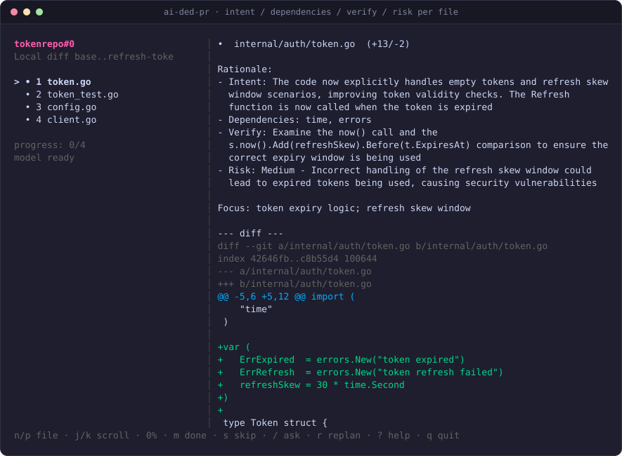
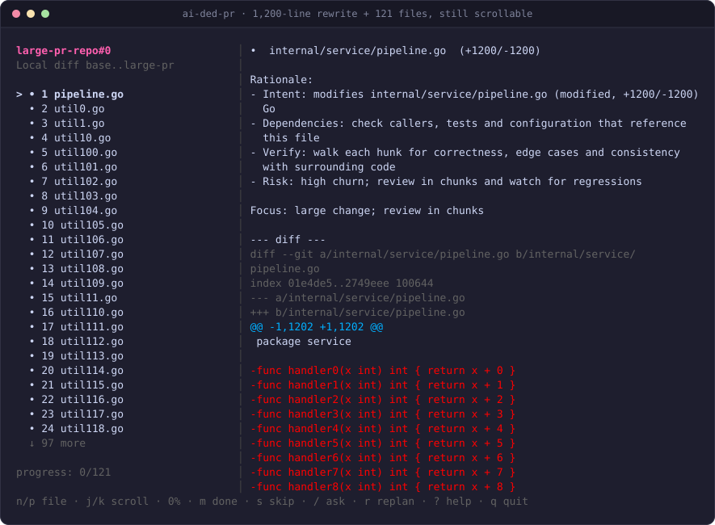
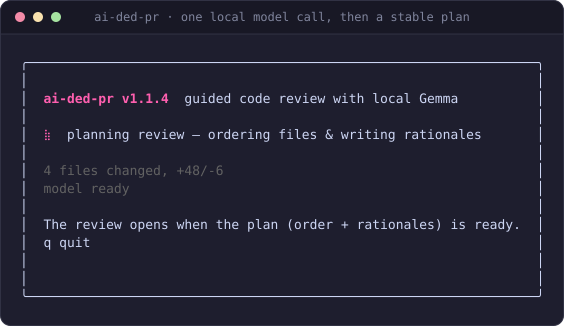

# 🧠 ai-ded-pr

**Review a PR like a teammate walked you through it.** One file at a time, in dependency
order, with a short note on what changed and what to check — before you read a line.

[](LICENSE)
[](https://go.dev)
[](#-requirements)




Local Gemma 3 4B on llama.cpp. ~2 GB of RAM. No account, no API key, nothing leaves your
machine.

## Why

`git diff` hands you files in alphabetical order and a wall of context-free lines. That's
not how a change works — and it's why a 1k-LOC PR takes an afternoon.

- **An order that matches the change.** Shared types and config first, then the core logic,
  each test right after the code it covers, then callers, docs and infra.
- **Every file speaks.** Four bullets per file — **Intent / Dependencies / Verify / Risk**.
  What it does, what else it touches, what to check, where it can bite. You get context
  before line one. No more opening 14 files to figure out where to start.
- **Jump to what matters.** Dependencies between changed files are read from the diff, not
  guessed. `1`–`9` jumps to a changed dependency, `b` brings you back.
- **One model call per PR.** The whole plan (order + rationales) comes from a single local
  pass, then it's persisted. Swapping files is instant; nothing regenerates behind your back.
- **Local and boring.** Gemma 3 4B Q4_K_M, ~2.5 GB download, ~2 GB resident, buttery smooth
  on a 16 GB M-series Mac. `llama-server` starts with the TUI and dies with it.

It won't magically make a 5,000-line PR small. It tells you where to start, what to check
and what you can skip — which is most of the work.

## Big PRs

1k LOC in one file is the case this was built for. It should be reviewable in one sitting.



- **The file list scrolls, the diff doesn't disappear.** With 121 files the sidebar windows
  around the current file (`↑/↓ N more`) instead of pushing the diff pane off-screen.
- **The whole diff renders.** A 1,200-line rewrite is ~2,400 diff lines; `j`/`k` and
  `pgup`/`pgdown` reach the last one, with the scroll position in the footer.
- **Code stays code.** Diff lines are hard-wrapped at the pane width, never reflowed —
  indentation, tabs and spacing survive. Prose (rationale, deps) still word-wraps.
- **No silent cuts.** A single file past 20,000 diff lines is capped with a visible
  `… N more lines not shown` marker. Below that, nothing is hidden.
- **Your place stays put.** Marking a file done keeps your scroll position; switching
  files starts at the top.

There is a fixture for exactly this: `scripts/make-large-pr-fixture.sh` builds a repo
with a 1,200-line single-file rewrite plus 120 other changed files. `make regression`
runs the render/scroll checks against it.

Startup is the next thing being cut down. The review opens only when the plan is ready —
until then you get a spinner, not a half-ordered file list:



## 🔧 Requirements

- macOS on Apple Silicon, 16 GB+ RAM
- [Homebrew](https://brew.sh) Go + llama.cpp: `brew install go llama.cpp`

## 📦 Install

```bash
git clone https://github.com/mohitpalsingh/ai-ded-PR.git
cd ai-ded-PR
./scripts/install.sh      # builds, links into ~/.local/bin, downloads the model
```

The model (~2.5 GB) is fetched once with resume support. Interrupted? The next run
continues where it stopped.

## 🚀 Use

```bash
ai-ded-pr                                  # review current repo changes
ai-ded-pr diff                             # same, explicit
ai-ded-pr branch-diff feature/AUD-13533-CMS-table-migration master
ai-ded-pr ask "where is auth handled?"     # find the files that matter
```

GitHub PRs:

```bash
ai-ded-pr --github https://github.com/owner/repo/pull/123
```

### Keys

| Key | What it does |
|---|---|
| `n` / `p` | next / previous file |
| `j` / `k` | scroll the diff (one line) |
| `pgup` / `pgdown` | scroll the diff (one page) |
| `1`–`9` | jump to a changed dependency of this file |
| `b` | return after a dependency jump |
| `m` | mark current file done |
| `s` | skip current file |
| `u` | unmark |
| `/` | ask the local model which files are relevant |
| `r` | regenerate the plan |
| `g` | new PR / source |
| `?` | help |
| `q` | quit |

Every file gets the same four bullets — **Intent / Dependencies / Verify / Risk** —
generated once, persisted, never recalculated.

## 🧩 How it works

```text
  git diff / GitHub PR ──► changed files + hunks
          │
          ▼
  local llama.cpp (Metal) ──► review plan: order + 4-bullet rationale per file
          │
          ▼
  TUI ──► walk files one by one · mark done/skip · ask questions
          │                       (state persisted per repo+commit)
          ▼
  q / Ctrl+C ──► server killed, ports released, zero residue
```

The plan is one model call. Everything after that — file switching, dependency jumps,
done/skip, scrolling — is local and instant.

## 💾 Footprint

| | |
|---|---|
| Model | Gemma 3 4B Q4_K_M (~2.5 GB, one-time download) |
| Runtime RAM | ~2 GB resident (llama-server), ~3 GB peak with the TUI open |
| Processes | `llama-server` starts with the TUI, dies with it — verified by `make regression` |
| Cache/state | `~/.cache/ai-pr-review/` (state per repo+commit, resumable model download) |
| Telemetry | none |

## 🧹 Uninstall

```bash
./scripts/uninstall.sh
```

Removes the binary, models, cache, state and logs. Leaves your Homebrew `go`/`llama.cpp` alone.

## 🛠 Extend

Hosts are pluggable: implement `hosts.Host` in `internal/hosts/<name>` for GitLab,
Bitbucket or Azure DevOps. PRs welcome.

## 🧪 Develop

```bash
make build        # binary in build/
make test         # go test + vet
make regression   # end-to-end: real repo, real model, large-PR fixture
```

Large-PR fixture, for manual TUI testing:

```bash
scripts/make-large-pr-fixture.sh                     # 1,200-line file + 121 files
ai-ded-pr --repo testdata/large-pr-repo --base base --head large-pr --no-ai
```

Screenshots are real captures of the TUI (`scripts/ansi2svg.py` turns a
`tmux capture-pane -e` into the SVGs in `docs/screenshots/`).

## Status

v1.1.4 — MIT License
